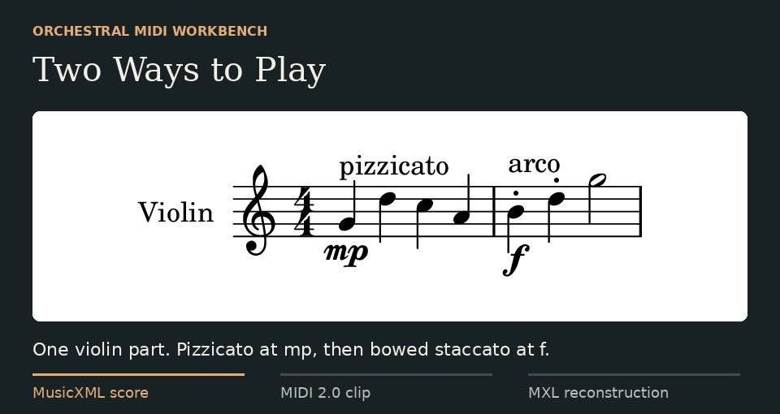

# Orchestral MIDI Workbench

AI companion tools for orchestral composition, from MusicXML scores to editable Bitwig performances and back.

Bring a score into Bitwig Studio 6.1, shape the performance with Kontakt instruments, and export the edited arrangement as MIDI 2.0 or a reconstructed score for analysis. The workbench pairs a standalone MusicXML converter with a Bitwig controller and task-specific skills for an AI agent.



## Try the converter

From the repository root, with the stable Rust toolchain installed, run:

```sh
cargo install --locked --path crates/convert
out=$(mktemp -d)
convert crates/convert/examples/violin.musicxml --to midi2 -o "$out/violin.midi2"
convert "$out/violin.midi2" --validate
convert "$out/violin.midi2" --to mxl -o "$out/violin.mxl"
```

The validation report inventories seven notes and the encoded pizzicato and staccato articulations. Open the resulting `violin.mxl` in a notation editor. Keep the generated `.convert.json` companion when you want source-aware restoration of a matching clip. Move it aside to see what the converter reconstructs from the MIDI performance alone. The forward conversion also saves the original source bytes alongside the clip.

## Realize and edit a score in Bitwig

Start with [the production workflow](skills/WORKFLOW.md). The skills help an agent choose documented patches, plan articulations and phrasing, write editable notes and automation, and inspect the result. Bitwig owns the saved arrangement, so you can continue editing in the DAW. Export can capture a whole arrangement or a track group, validate a self-contained MIDI 2.0 clip, and reconstruct MusicXML or compressed MXL for harmonic, rhythmic, and orchestration analysis. [Bitwig adapter setup](crates/controller/adapters/bitwig-ctl/README.md) · [Kontakt loader setup](crates/controller/adapters/kontakt-ctl/README.md) · [MIDI 2.0 export](skills/bitwig-export-midi2/SKILL.md)

## How articulations and expression travel

**In the file**, the converter prototypes the MIDI-CI Orchestral Articulation Profile. A supported technique such as pizzicato is stored in a MIDI 2.0 Note On attribute. The clip declares the profile and carries the performed notes and controls. A printed dynamic can inform attack velocity or continuous controls as part of the rendition. Profile declarations describe the clip encoding. Live negotiation and playback depend on the receiving instrument. [Orchestral Articulation Profile](https://midi.org/midi-ci-profile-for-note-on-selection-of-orchestral-articulation) · [MIDI Clip File specification](https://midi.org/midi-clip-file-specification-smf-midi-2-0)

**In Bitwig**, articulated parts use channels 2–16 for musical and keyswitch notes. The note channel selects the Kontakt instrument or articulation slot. Channel 1 carries a single shared automation lane per control. Each slot's Channel Filter admits its own note channels and the shared channel 1. Its Channel Map then sends those messages to channel 1 at Kontakt. That lets one dynamic curve follow the phrase as it moves between patches. For example, when a patch supports it, CC1 crossfades sampled dynamic layers while CC11 shapes phrase level. [Bitwig MIDI devices](https://www.bitwig.com/userguide/latest/midi/) · [Routing and expression conventions](skills/WORKFLOW.md#expression-control-specification)

**On export**, the bridge reads that routing and translates recognized articulation slots into MIDI 2.0 note attributes. An ambiguous slot name becomes a performance remark. Reconstructing a score from edited DAW timing involves notation choices such as quantization and voice assignment. Keep the source score when you need the original engraving. [Capture and reconstruction](crates/controller/ARCHITECTURE.md#self-contained-midi2-export)

## Project status

The converter runs independently of Bitwig or Kontakt. The live workflow targets the exact Bitwig Studio 6.1 host build and a provisioned Kontakt 7 setup under Wine on Linux. See the [verification guide](docs/CICD.md) for reproducible converter checks and the scope of native testing.

[Contributing](CONTRIBUTING.md) · [Architecture](docs/ARCHITECTURE.md) · [MIT License](LICENSE)
